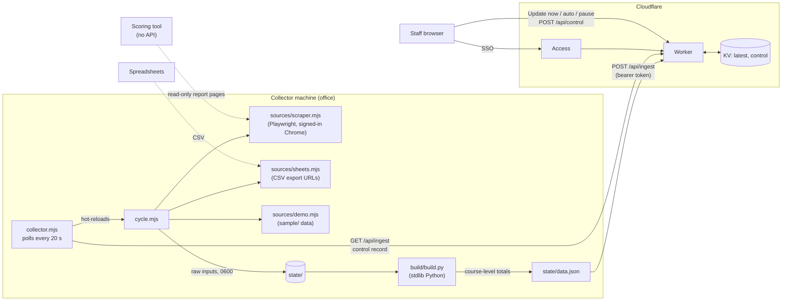

# Results pipeline dashboard

A live operations dashboard that tracks around 1,000 courses through the
post-exam results pipeline:

> scores loaded in the scoring tool → shared with faculty → signed off →
> verified → certificates generated → results published

Staff open one protected page and see where every course is, what is stuck
between two steps, and who has to act next. They press **Update now** (or
**Start auto-update**) on the page, and a collector on an office machine
reads the sources and refreshes it.

> All data in this repository is synthetic. Course codes, course names,
> reviewer labels, URLs and numbers are made up by `sample/generate.py`.

## The problem

The facts about each course are spread across several places:

- a **web scoring tool** with workflow flags per course (opened, QP check,
  moderation, score summary, sign-off, verified), a per-shift checklist and
  course statistics. It has **no API**, only report pages behind a browser
  sign-in;
- three **spreadsheets the team edits by hand**: a release planner, an
  after-sign-off check, and a sign-off/publishing tracker. People insert
  columns, type dates in whatever format they like, and leave rows half filled.

Answering "which courses are signed off but not verified?" meant opening four
tabs and cross-referencing by eye. This project does the cross-referencing,
turns the result into course-level totals, and puts them on one page.

## Architecture



1. **Dashboard-driven reads.** A button on the page writes a small control
   record in KV (`{mode, requested_at, requested_by}`). The collector polls
   it every 20 seconds and reads the sources only when someone asked, or
   every 5 minutes while auto-update is on. Nobody needs to touch the
   collector machine, and the sources are not hit around the clock.
2. **Collect.** Adapters read each source and save the raw inputs into
   `state/` with mode `0600`.
3. **Build.** `build/build.py` joins everything by course code and writes
   `state/data.json`: per-course stage and flags plus totals, gap lists,
   a work queue and so on. No candidate data exists in the inputs or the output.
4. **Publish.** The collector POSTs `data.json` to the Worker, which stores
   it in KV and serves the dashboard with the data inlined.

## What is on the dashboard

| Section | What it answers |
|---|---|
| Header | When the data was built; **Update now**, **Start auto-update** and **Pause** buttons; a banner while a requested update is still pending |
| Sources | Status of each source (ok / partial / expired / failed), when it was read, and exam-shift completion |
| Summary tiles | Courses, scores loaded, signed off, verified, certificates, published, open issues, overall pass % |
| Release summary | Counts for every step from the planner to the SMS going out, each with an expandable course list (sub-rows indented) |
| Online vs offline | Scoring-tool stage counts by exam type |
| Where courses are waiting | One expandable row per hand-off between two consecutive steps, listing the courses stuck there |
| Pending work queue | The single next action for every active course, its owner team and how many days it has waited, oldest first, filterable |
| Sign-offs per day | Inline SVG bar chart for the last 21 days |
| Recent sign-offs | Latest sign-offs and whether each is verified yet |
| Certificates / Publishing | Progress bars with lists of what is pending (live, announcement, SMS, email, coordinator mail) |
| Courses by exam date | Progress per exam sitting |
| Re-evaluations | Courses with a re-evaluation request and its status |
| Course register | Every course: searchable, sortable and filterable by stage. Clicking any course chip elsewhere jumps here |
| How to read this | Definitions of the stages and statuses, in the page itself |

It is one self-contained HTML file (`worker/src/page.html`, vanilla JS, no
build step). It follows `prefers-color-scheme` for light and dark, works at
phone width, uses real buttons, labels and table headers, and never puts data
into `innerHTML`.

## Quick start (2 minutes, no accounts needed)

Requires Node 18+ and Python 3.10+ (stdlib only; 3.9 also works).

```sh
python3 sample/generate.py && node collector/collector.mjs --local --once
open preview.html        # or xdg-open / start
```

`--local` skips the Worker and writes `preview.html`, the real dashboard
page with the data inlined. The control buttons are disabled there, with a
tooltip saying why. Run the command again and a few courses move forward:
the demo adapter advances random workflow steps on each cycle.

To run the Worker tests (no wrangler needed):

```sh
cd worker && node --test test/worker.test.mjs
```

## Full setup

### 1. Worker and KV

```sh
cd worker
npm install                                  # wrangler as a local dev dependency
cp wrangler.toml.example wrangler.toml
npx wrangler kv namespace create DASH_KV     # paste the id into wrangler.toml
npx wrangler secret put INGEST_TOKEN         # 32+ random chars, e.g. `openssl rand -hex 32`
npx wrangler deploy
```

### 2. Cloudflare Access

In Zero Trust → Access → Applications, add a **self-hosted** application for
the Worker's hostname. Add a policy that allows your team (email domain or
group), and add a **bypass** policy for the path `/api/ingest` only, so the
collector can reach it with its bearer token. Copy the application's
**AUD tag** and your team domain into `wrangler.toml` (`ACCESS_AUD`,
`ACCESS_TEAM_DOMAIN`) and deploy again.

The Worker checks the `Cf-Access-Jwt-Assertion` header on every route
except `/api/ingest`. It verifies the RS256 signature against
`https://<team>/cdn-cgi/access/certs` and checks `aud`, `iss` and `exp`. If
Access is missing or misconfigured the Worker returns 403. It never serves the
page "open" by mistake.

### 3. Collector

```sh
cp collector/config.example.json collector/config.json
# set ingest_url (https://<worker-host>/api/ingest), ingest_token,
# source: "live", the three sheet CSV export URLs, and the report pages
npm install --prefix collector playwright-core   # only needed for the scraper
tmux new -s collector 'node collector/collector.mjs'
```

On the first live cycle a Chrome window opens with a dedicated profile in
`profile/`. Sign in to the scoring tool there once. Then detach from tmux
(`Ctrl-b d`) and leave it running. When a source shows **expired** on the
dashboard, reattach and sign in again.

### Local Worker development

```sh
cd worker && npm run dev      # http://localhost:8787
```

`npm run dev` passes `ALLOW_DEV=1` and a throwaway ingest token on the
command line. The Access check is skipped only when `ALLOW_DEV` is exactly
`"1"` **and** the request is addressed to `localhost` or `127.0.0.1`. A
deployed Worker never sees those hostnames, so the bypass cannot apply in
production even if someone sets the variable by mistake. Don't put
`ALLOW_DEV` in `wrangler.toml`. To feed the dev Worker, point a local
`config.json` at `http://localhost:8787/api/ingest` with the same token.

## Privacy and security design

- **Only course-level totals leave the machine.** The inputs are course-level
  reports, and the build writes only per-course fields and aggregates. Staff
  names in the "Person Checked" column become a yes/no flag.
- **Raw reads stay local.** Everything the adapters fetch goes into `state/`
  (directory `0700`, files `0600`). That folder, `config.json` and the browser
  `profile/` are gitignored.
- **Access-protected page.** The page, `/api/meta` and `/api/control` all
  require a verified Access JWT. The ingest token can only write data and
  read the control record. It cannot open the dashboard.
- **Token comparison in constant time.** Both strings are SHA-256 hashed and
  the digests compared byte by byte.
- **Ingest validation.** JSON content type, a 5 MB limit, a schema version,
  required sections and short course ids are all checked before anything is
  stored.
- **No cross-site control.** `/api/control` accepts only
  `application/json`, which a plain HTML form cannot send. Requests with a
  foreign `Origin` are refused. Each change records who made it.
- **Strict headers.** A per-request nonce CSP (`default-src 'none'`), `nosniff`,
  `no-referrer`, `frame-ancestors 'none'` and `no-store`. Data is inlined as
  `application/json` with every `<` escaped, so a course name containing
  `</script>` can't break out.

## Design notes

**Hot reload without losing the sign-in.** The scoring tool needs a real
browser sign-in, sometimes with a one-time code, and the session cookie
does not survive a browser restart. `collector.mjs` holds that browser in
a `shared` object and re-imports `cycle.mjs` (and the adapters) with a
cache-busting `?v=<mtime>` query whenever their files change. A fix to a
selector or a build step takes effect on the next tick, and the signed-in
Chrome window stays open. The module is re-imported only when an mtime
changes, so module copies don't pile up in memory.

**Columns by header name.** Spreadsheet columns are looked up by header
text (case and punctuation are ignored, and a few accepted spellings are
listed per field in `COLUMNS`), never by position. If someone inserts a
column, nothing breaks. If someone renames a required header, the build
stops with a message that names the missing column and lists the headers it
found, instead of quietly filling the dashboard with blanks. Dates are
accepted as `2026-11-03`, `03/11/2026`, `3-Nov-2026`, `Nov 3, 2026`,
`03.11.2026` and so on. Numeric dates are read day-first.

**Keep the last good read.** A source that fails never overwrites its
previous file in `state/`, so the dashboard keeps showing the last good data
and flags the source:

- The sheets adapter saves a response only if it is really `text/csv`. An
  expired session returns an HTML sign-in page with HTTP 200, which would
  otherwise be saved as data.
- The scraper detects sign-in pages and redirects (**expired**).
- When a report page loads without its table, the scraper keeps that
  table's previous read and marks the source **partial**.
- DataTables-paginated tables are read in full, either with "show all" or by
  clicking through the pages.

**Requests before start-up count as handled.** When the collector starts, it
takes the current `requested_at` as already done. Restarting it never fires
an unexpected read because of a button someone pressed yesterday.

**Python for the build, isolated.** The build is stdlib-only Python run as
`python3 -I` (isolated mode: no `PYTHON*` environment variables, no user site
packages). It runs on any machine that has Python, with nothing to install.

## Repository layout

```
collector/
  collector.mjs        polling loop, hot reload, --local / --once
  cycle.mjs            read → save raw → build → post (or write preview.html)
  sources/demo.mjs     sample data with small random progress
  sources/sheets.mjs   CSV export URLs, content-type checked
  sources/scraper.mjs  example Playwright adapter (optional dependency)
  config.example.json
build/build.py         joins sources, derives stages, writes data.json
worker/
  src/index.js         Worker entry
  src/app.js           routes, Access gate, control record
  src/lib.js           JWT verification, constant-time compare, validation, headers
  src/render.js        inlines data into the page (shared with --local)
  src/page.html        the dashboard
  test/worker.test.mjs node --test suite
  wrangler.toml.example
sample/
  generate.py          seeded generator for ~120 fictional courses, 6 sittings
  tool.json, planner.csv, aftercheck.csv, signoff.csv
```

## License

MIT. See [LICENSE](LICENSE).
